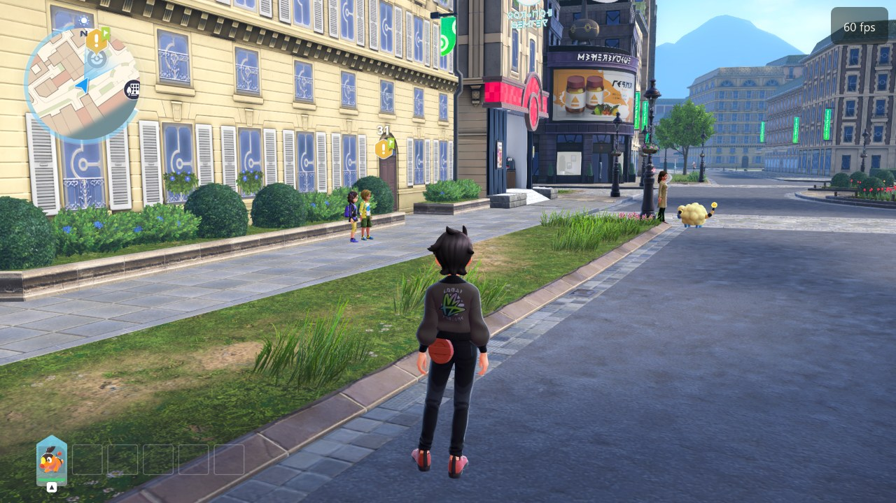
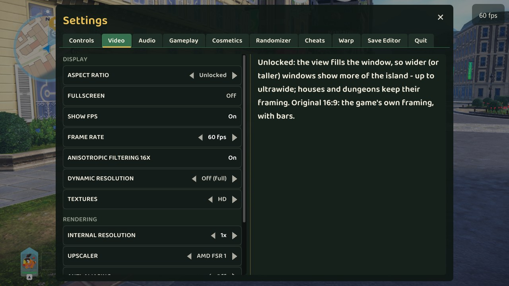
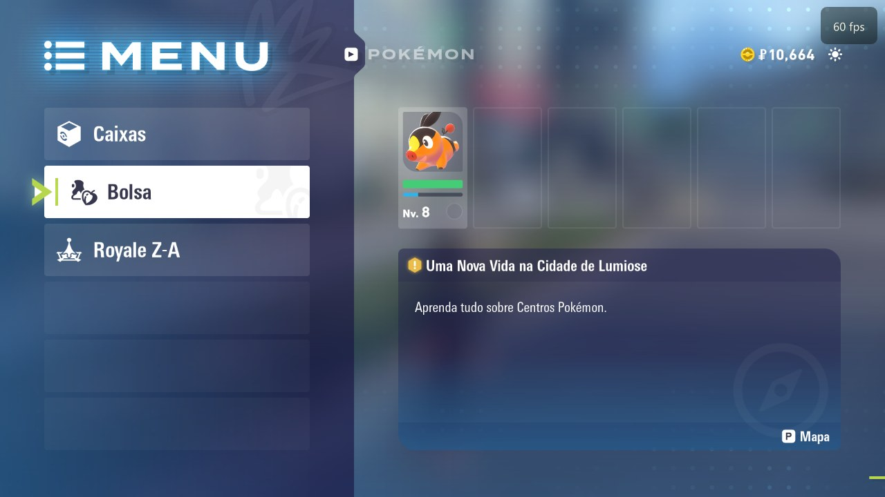
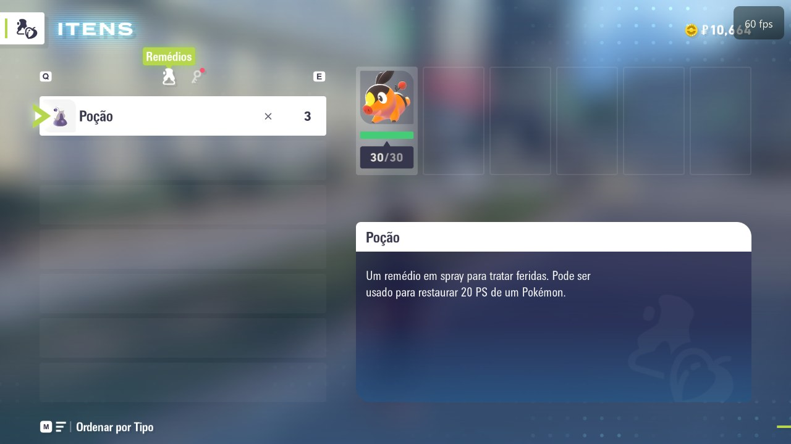

# ZA Recomp

**English** | [Português (Brasil)](README.pt-BR.md)

A native PC port of **Pokémon Legends: Z-A** (Nintendo Switch, v1.0.0 and v2.0.0) built by **static recompilation**:
the game's ARM64 code is translated ahead of time into C and compiled for x86-64, and the Switch's operating system
and GPU (NVN) are reimplemented on the PC (Vulkan). No emulator runs at play time.

This is a fork of **[LAS Recomp](https://github.com/peiikai/LASRecomp)** by **Peiikai** - the recompiler, the runtime
and the NVN-to-Vulkan / Maxwell shader translation all come from that project, made for *The Legend of Zelda:
Link's Awakening*. This fork extends it to run Pokémon Legends: Z-A.

## Screenshots

| | |
|---|---|
|  |  |
| Lumiose City, 60 fps | The port's settings menu (F1) |
|  |  |
| The game's menu (Brazilian Portuguese translation mod) | The bag |

## Status

Work in progress, playable: it boots, goes through the intro and the first story beats in Lumiose City, battles
work, and it runs at a steady 60 fps on a desktop GPU.

Working:
- Rendering: characters, animation (GPU skinning / transform feedback), lighting, GPU-driven culling (with the game's
  hierarchical-Z occlusion), text, dialogue and UI
- **60 fps** (the Switch version is 30) at the game's normal speed, or 30 fps as on the console - menu option
- Native resolution rendering (1x = 1080p and up), 16x anisotropic filtering, SMAA / FSR 1 options
- Controller (XInput / SDL3 gamepads), keyboard and mouse camera
- Button glyphs for Xbox controllers (LB RB LT RT Menu View) or the keyboard (key names) in the game's text
- HD texture packs: dump the game's textures, upscale them, load them back (see below)
- Saves (the game's autosave and manual saves)

Known issues:
- Some UI icons (camera mode, the title screen's PRESS A) are drawn from the game's own files and still show the
  Switch's buttons
- Occasional short black flash; pink stripe artifacts on some walls at night
- Only tested on Windows with an NVIDIA GPU so far (the code base also builds on Linux, untested for Z-A)
- **On a Mac:** see [MonZaMac](https://github.com/lucabravi/MonZaMac) by [@lucabravi](https://github.com/lucabravi),
  a native macOS port based on this project

## Playing

Requirements: Windows 10 (1903+) / 11 64-bit, a CPU from 2013 or newer with AVX2 (older ones with SSE4.2, e.g. 2nd/3rd gen Core i5, also work but run the game slower), a GPU with Vulkan 1.3 and an up-to-date driver, ~12 GB free.

What you need from your own console (none of it is included):
- **The game**: your dump of Pokémon Legends: Z-A - the base game (`.xci` or `.nsp`), optionally the **2.0.0 update**
  and the DLC (`.nsp`). Versions 1.0.0 and 2.0.0 are supported.
- **`prod.keys`** (and `title.keys`) dumped from your Switch (Lockpick_RCM).

1. Download the release zip and extract it anywhere (e.g. `C:\Games\ZA Recomp`).
2. Put your `.xci` / `.nsp` files and your `prod.keys` / `title.keys` together in one folder.
3. Run `lasrecomp.exe`. On the start screen: **Game files folder** -> choose that folder -> **Set up game files**.
   - It reads the game from your files (about a minute) and then **recompiles the game into a native PC program on
     your machine** (10-30 minutes, depending on your CPU). This happens **only once**: the next time the game starts
     straight away. Your own files aren't changed.
   - A new ZA Recomp version that changes the recompiler rebuilds it from the files already set up (no need to pick
     the folder again).
4. Play. The log goes to `lasrecomp.log` next to the exe.

Optional: your console's system fonts in `fonts/` (`tools/za/nca_font.py` extracts them from a firmware dump with your
own keys), then `python tools/za/xbox_font.py` and `python tools/za/keyboard_font.py` for the button glyphs. Without
them the game's text uses a Windows font and the button icons are missing.

### Saves

New games start with an empty save. Saves are kept in `save/save_0/` next to the exe - the game's own save files,
the same as on the Switch, so they move between the two without converting anything:

- **Switch -> PC**: on a modded Switch, back the save up with **JKSV** (the game, then your user). Copy the backup
  folder from the SD card (`JKSV/Pokémon Legends Z-A/<user - date>/`, it holds the file `main`) to the PC, then on the
  start screen: **Game files** -> **Import save** -> choose that folder (or the game's JKSV folder: its newest backup
  is used). Your current save is moved to `save/backup-<date>/` first.
- **PC -> Switch**: copy the files in `save/save_0/` into a JKSV backup folder on the SD card and restore it with JKSV.
- **Versions**: a save from 2.0.0 needs the game set up with the 2.0.0 update. 2.0.0 converts a 1.0.0 save the first
  time it saves, and that save no longer loads on 1.0.0 - keep a backup.

Controls (keyboard): WASD move, arrows d-pad, Enter = A, Backspace = B, L = X, I = Y, Q / E = L / R, 1 / 3 = ZL / ZR,
P = +, M = -, right mouse button + mouse = camera. F1 opens the port's menu (frame rate, FPS counter, resolution,
filtering, controls, button icons). F11 / Alt+Enter: fullscreen.

Settings (`larecomp.ini`, also editable from the F1 menu):

| Setting | Meaning |
|---|---|
| `fps60 = 1` | 60 fps (0: 30 fps as on the Switch) |
| `resolution = 1x` | internal resolution (`match` = window size, `1x`..`4x` = 1080p x N) |
| `aniso16 = 1` | 16x anisotropic filtering |
| `prompts = auto` | button glyphs: keyboard without a controller, Xbox with an Xbox pad (`keyboard`, `xbox`, `nintendo` force one) |
| `bind_pad_a = south` ... | controller mapping (by letter: the Xbox pad's A is the game's A) |
| `tex_hd = 1` / `tex_dump = 0` | HD texture packs on / dump the game's textures |

### HD textures

1. Play with `tex_dump = 1` (or `LARECOMP_TEX_DUMP=1`): every texture the game loads is saved as
   `textures/dump/<hash>.png`.
2. `python tools/za/upscale_textures.py` builds `textures/hd/` from it - colour textures only (normal maps and masks
   keep the game's own), with [Real-ESRGAN](https://github.com/xinntao/Real-ESRGAN) (ncnn-vulkan build in
   `tools/realesrgan/`) or a Lanczos fallback.
3. Textures in `textures/hd/` are used automatically, at any size.

## Building from source (Windows)

Uses MSYS2 (UCRT64: clang, SDL3, FFmpeg, shaderc, Vulkan headers) and Python 3 - see
[docs/BUILD-windows.md](docs/BUILD-windows.md) for the packages.

```sh
make gen                                   # lift the game's code (extracted/exefs) to C: generated/
make -j16 B=build/o1 GENARCH=-march=x86-64-v3 GENOPT="-O1 -DGUEST_VOLATILE"
```

`build/o1/lasrecomp.exe` + `build/o1/lasgame.dll` (set `LARECOMP_GAME_LIB` to the dll when running from the build
folder). `bash tools/za/dist.sh` builds the release folder (`build/dist-za/ZA Recomp/`, `ZIP=1` for the zip): the exe
without any game code, the game file importer (`tools/zaimport`, .NET 8 + LibHac), the frozen generator and the zig
compiler the start screen recompiles the game with. `tools/za/` also has the scripts used during development: `build-win.sh`, `play-win.sh`, `auto-win.sh`
(scripted test runs on a scratch save copy), log / profile helpers.

Game-specific patches to the lifted code (the frame-rate hook) are in `tools/patches.py` (`ZA_PATCHES`, keyed by the
game's build ID); everything else is in the runtime (`runtime/`): the HLE services, the NVN implementation
(`runtime/nvn/`), the Vulkan backend (`runtime/nvn/vulkan/`) and the Maxwell shader translator
(`runtime/nvn/maxwell/`).

## Credits

- **[Peiikai](https://github.com/peiikai)** - creator of [LAS Recomp](https://github.com/peiikai/LASRecomp): the static
  recompiler, the runtime, the NVN / Vulkan / Metal renderers and the shader translator this port is built on.
- **LAS Recomp contributors** - [@dvilelaf](https://github.com/dvilelaf), [@Tensorlong](https://github.com/Tensorlong),
  [@mansarip](https://github.com/mansarip), [@we11adam](https://github.com/we11adam),
  [@Maganra](https://github.com/Maganra), [@hjqcan](https://github.com/hjqcan),
  [@gitarre1234rr5](https://github.com/gitarre1234rr5), [@rkammoun](https://github.com/rkammoun) and everyone who
  reported issues - see [docs/LASRecomp-README.md](docs/LASRecomp-README.md#credits) for what each contributed.
- **[Hexveil404](https://github.com/Hexveil404)** - the Pokémon Legends: Z-A port (this fork).
- **[lucabravi](https://github.com/lucabravi)** - [MonZaMac](https://github.com/lucabravi/MonZaMac), the native macOS
  port of ZA Recomp.
- **[Ryujinx](https://github.com/Ryujinx/Ryujinx)** - used as a behavioural reference while porting (no code taken).
- **[envytools](https://github.com/envytools/envytools)** and **[Switchbrew](https://switchbrew.org)** - NVIDIA GPU and
  Switch system documentation.
- Libraries: [SDL 3](https://libsdl.org), [FFmpeg](https://ffmpeg.org), [Dear ImGui](https://github.com/ocornut/imgui),
  [Vulkan Memory Allocator](https://github.com/GPUOpen-LibrariesAndSDKs/VulkanMemoryAllocator),
  [SMAA](https://github.com/iryoku/smaa), [AMD FSR 1](https://github.com/GPUOpen-Effects/FidelityFX-FSR),
  [shaderc](https://github.com/google/shaderc), [Capstone](https://www.capstone-engine.org),
  [Unicorn](https://www.unicorn-engine.org) and the others listed in
  [docs/LASRecomp-README.md](docs/LASRecomp-README.md#credits), with their licenses and sources.

## Legal

ZA Recomp is a fan project, not affiliated with, endorsed or sponsored by Nintendo, Game Freak, Creatures or The
Pokémon Company. *Pokémon* and *Pokémon Legends: Z-A* are trademarks of Nintendo / Creatures / GAME FREAK / The
Pokémon Company. No game files, game code, assets or fonts are included. You must provide your own legally obtained
copy of the game.

## License

The code is under the [MIT License](LICENSE) (LAS Recomp © Peiikai; the Z-A additions under the same license).
Third-party components keep their own licenses - see
[docs/LASRecomp-README.md](docs/LASRecomp-README.md#license) for the full list and the sources of the bundled components.
